# Manual de uso do QualiR

Este manual explica como instalar e usar o QualiR para analisar entrevistas, grupos focais e outros textos, sozinho ou em equipe.

## Sumário

1. [Instalação](#1-instalação)
2. [Abrir e fechar o programa](#2-abrir-e-fechar-o-programa)
3. [Projetos e usuários](#3-projetos-e-usuários)
4. [Conhecendo a tela](#4-conhecendo-a-tela)
5. [Importar arquivos e transcrições](#5-importar-arquivos-e-transcrições)
6. [Nós: criar e organizar](#6-nós-criar-e-organizar)
7. [Codificar](#7-codificar)
8. [Casos e classificações](#8-casos-e-classificações)
9. [Memorandos e anotações](#9-memorandos-e-anotações)
10. [Conjuntos e relacionamentos](#10-conjuntos-e-relacionamentos)
11. [Consultas](#11-consultas)
12. [Visualizações e relatórios](#12-visualizações-e-relatórios)
13. [Trabalho em equipe](#13-trabalho-em-equipe)
14. [Exportar, fazer cópia de segurança e proteger os dados](#14-exportar-fazer-cópia-de-segurança-e-proteger-os-dados)
15. [Atalhos e dicas](#15-atalhos-e-dicas)
16. [Solução de problemas](#16-solução-de-problemas)

---

## 1. Instalação

A instalação é feita uma única vez em cada computador.

### 1.1 Instale o R

Baixe em **https://cran.r-project.org**:
- **Windows:** *Download R for Windows* > *base* > baixe e instale com as opções padrão.
- **Mac:** *Download R for macOS* e escolha **arm64** (chips M1 a M4) ou **x86_64** (Mac Intel).
- **Linux (Ubuntu/Debian):** `sudo apt install r-base`.

Use a versão **4.2 ou mais recente**; versões antigas mostram acentos errados.

### 1.2 Instale o RStudio (opcional, recomendado)

Baixe em **https://posit.co/download/rstudio-desktop** e instale com as opções padrão.

### 1.3 Baixe o QualiR

No GitHub, clique no botão verde **Code > Download ZIP**. Extraia o arquivo (no Windows: botão direito > *Extrair tudo*), de preferência em **Documentos**.

Confira se o `app.R` está direto dentro da pasta. Às vezes o Windows cria uma pasta dentro de outra (`qualiR\qualiR\app.R`); nesse caso, use a pasta de dentro.

### 1.4 Instale os pacotes

Abra o RStudio e digite no **Console**:

```r
setwd(choose.dir())            # abre uma janela: escolha a pasta do QualiR
file.exists("app.R")           # deve responder TRUE
source("instalar_pacotes.R")
```

No Mac ou no Linux, troque a primeira linha por `setwd("~/Documents/qualiR")`, com o caminho da sua pasta.

Durante a instalação podem aparecer perguntas:

| Pergunta | Resposta |
|---|---|
| *Would you like to use a personal library instead?* | **yes** |
| *Would you like to create a personal library…?* | **yes** |
| *Do you want to install from sources…?* | **no** |
| Escolha de espelho (*CRAN mirror*) | qualquer um do Brasil |

Um aviso sobre **Rtools** pode ser ignorado.

**No Linux**, instale antes estas bibliotecas do sistema:
`sudo apt install libsodium-dev libpoppler-cpp-dev libxml2-dev libssl-dev libcurl4-openssl-dev libfontconfig1-dev`

---

## 2. Abrir e fechar o programa

**Windows, com dois cliques:** dê dois cliques em **`Iniciar QualiR.bat`**, dentro da pasta. Abre uma janela preta e, em seguida, o navegador. A janela preta precisa ficar aberta enquanto você usa o programa. Para criar um atalho na Área de Trabalho: botão direito no arquivo > *Mostrar mais opções* > *Enviar para* > *Área de trabalho*.

Na primeira vez, o Windows pode mostrar "O Windows protegeu o computador". Clique em *Mais informações* > *Executar assim mesmo*.

**Pelo RStudio (qualquer sistema):**

```r
setwd(choose.dir())     # escolha a pasta do QualiR
shiny::runApp(".")
```

**Para fechar:** feche a janela preta, ou clique em **Stop** no Console do RStudio. Fechar só a aba do navegador não encerra o programa.

Ao abrir, aparece a **tela de entrada**, onde você escolhe o projeto e informa usuário e senha (seção 3).

---

## 3. Projetos e usuários

Cada **projeto** é uma análise independente, com seus próprios arquivos, nós, casos, consultas e **usuários**. Você pode ter quantos projetos quiser, por exemplo um para cada pesquisa.

### 3.1 Primeiro acesso: criar o primeiro projeto

Na primeira vez, a tela de entrada mostra **Criar o primeiro projeto**:

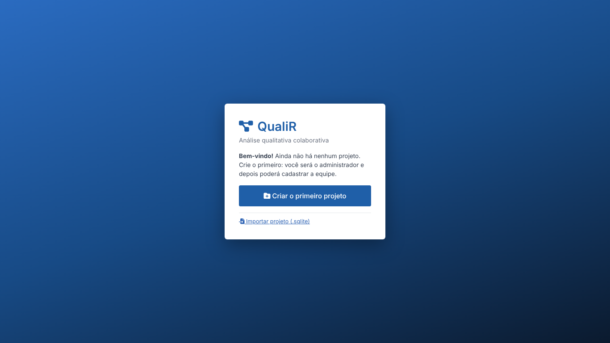

1. Informe o **nome do projeto**, por exemplo "Trajetórias escolares 2026".
2. Crie o **administrador** do projeto (você): usuário, nome e senha (mínimo de 4 caracteres).
3. Clique em **Criar projeto**.

### 3.2 Entrar em um projeto

Na tela de entrada, escolha o **Projeto** na lista, informe **usuário** e **senha** e clique em **Entrar** (ou tecle Enter).

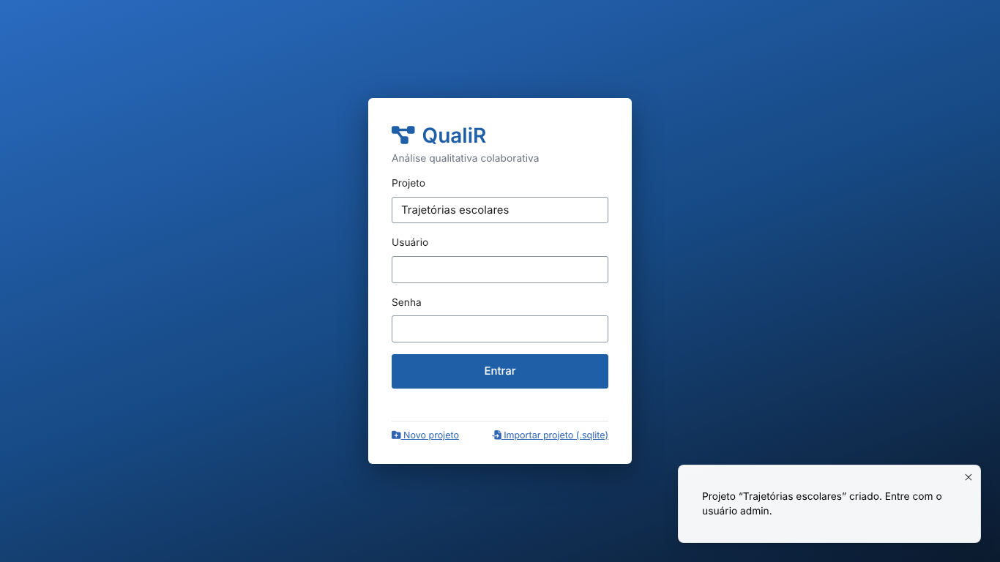

Os usuários são **de cada projeto**: uma pessoa cadastrada no projeto A não entra no projeto B, a menos que também seja cadastrada nele.

### 3.3 Criar um novo projeto

Use **Arquivo > Novo projeto**, ou o link **Novo projeto** na tela de entrada:
- **De dentro do programa:** basta dar o nome. Você será o administrador do novo projeto, com o **mesmo usuário e senha**. Depois de criar, o programa pergunta se você quer abri-lo.
- **Pela tela de entrada:** além do nome, você cria o usuário administrador.

### 3.4 Abrir outro projeto

**Arquivo > Abrir projeto** lista todos os projetos, com o nome, o arquivo e a data da última modificação. Clique em **Abrir** e entre com o usuário e a senha daquele projeto.

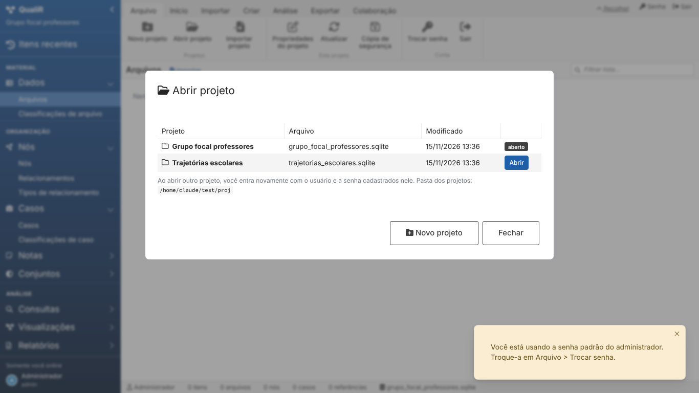

Para trocar de projeto também dá para usar **Sair** e escolher outro na tela de entrada.

### 3.5 Importar um projeto ou restaurar uma cópia de segurança

**Arquivo > Importar projeto** (ou **Importar projeto (.sqlite)** na tela de entrada) recebe um arquivo de projeto `.sqlite`: uma cópia de segurança sua ou um projeto enviado por outra pessoa. O arquivo é copiado para a pasta de projetos e passa a aparecer na lista. Se já existir um projeto com o mesmo nome, o importado recebe "(importado em dd/mm/aaaa)" no nome. Entre nele com um usuário cadastrado no projeto importado.

### 3.6 Onde ficam os projetos

Os projetos ficam na pasta **`projetos`**, dentro da pasta do QualiR, um arquivo `.sqlite` por projeto. O caminho completo aparece na janela **Abrir projeto**. Para guardá-los em outro lugar (uma pasta sincronizada com backup, por exemplo), defina a pasta antes de abrir o programa:

```r
Sys.setenv(QUALIR_PROJETOS = "C:/Pesquisas/QualiR")
shiny::runApp(".")
```

Quem usava uma versão anterior do QualiR (arquivo `projeto_qualir.sqlite` direto na pasta do programa) não perde nada: na primeira abertura, o projeto é movido automaticamente para a pasta `projetos`.

Para mudar o nome de um projeto: **Arquivo > Propriedades do projeto** (administrador).

### 3.7 Usuários e perfis

**Criar contas para a equipe** (somente o administrador): barra lateral **Equipe > Usuários** > **Novo usuário**. Defina login, nome, senha inicial e perfil:

| Perfil | Pode |
|---|---|
| **Administrador** | tudo, inclusive gerenciar usuários, excluir qualquer codificação e fazer cópias de segurança |
| **Pesquisador(a)** | importar, criar nós, codificar, escrever notas e rodar consultas |
| **Leitor(a)** | apenas visualizar |

Dê duplo clique em um usuário para mudar nome, perfil, cor (usada nas faixas por codificador), redefinir a senha ou desativar a conta. Cada pessoa troca a própria senha em **Arquivo > Trocar senha**.

---

## 4. Conhecendo a tela

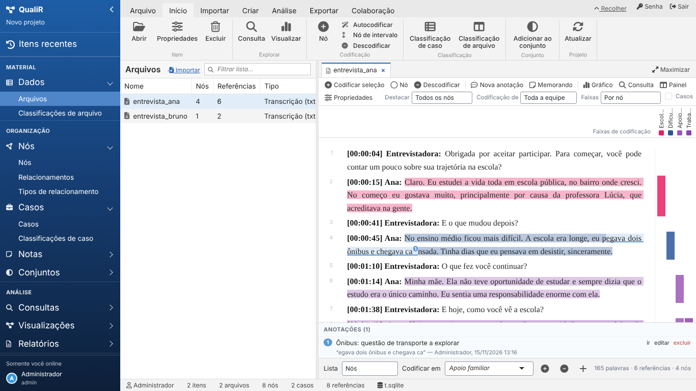

| Área | Para que serve |
|---|---|
| **Barra lateral** (azul, à esquerda) | Navega pelas partes do projeto. Os grupos (Dados, Nós, Casos…) abrem e fecham com um clique. A seta **<** recolhe a barra |
| **Faixa de opções** (topo) | Abas **Arquivo** (novo, abrir e importar projeto, cópia de segurança, senha, sair), **Início, Importar, Criar, Análise, Exportar e Colaboração**. **Recolher** (canto direito) esconde a faixa para ganhar espaço |
| **Lista** (centro) | Mostra os itens da seção escolhida. Clique para selecionar, dê duplo clique para abrir, clique no cabeçalho para ordenar e use **Filtrar lista…** para buscar |
| **Detalhe** (direita) | Mostra o item aberto. Cada item abre em uma **aba**; o **×** fecha a aba e **Maximizar** esconde a lista |
| **Barra de status** (rodapé) | Usuário atual e totais do projeto |

**Seções da barra lateral:**
- **Itens recentes:** o que você abriu por último.
- **Dados:** Arquivos e Classificações de arquivo.
- **Nós:** Nós, Relacionamentos e Tipos de relacionamento.
- **Casos:** Casos e Classificações de caso.
- **Notas:** Memorandos e Anotações.
- **Conjuntos.**
- **Consultas:** Consultas, Resultados da consulta e Matrizes de codificação.
- **Visualizações:** Mapas e gráficos.
- **Relatórios.**
- **Equipe:** Atividade e Usuários.

**Para ler textos longos em telas pequenas:** clique em **Recolher** (faixa de opções) e em **Maximizar** (aba do documento). O texto passa a ocupar quase a tela toda.

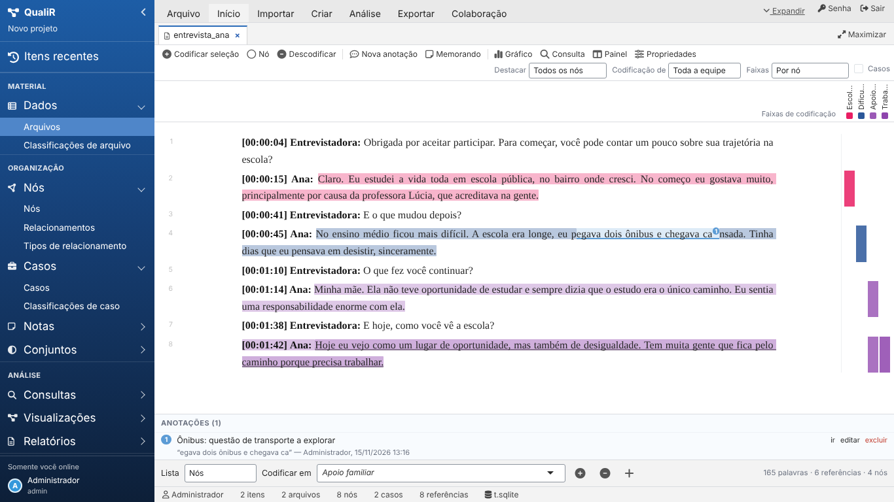

---

## 5. Importar arquivos e transcrições

### 5.1 Arquivos

**Importar > Arquivos** aceita vários arquivos de uma vez:

| Formato | Observação |
|---|---|
| `.txt`, `.md` | UTF-8 ou Latin-1 |
| `.docx` | parágrafos e tabelas |
| `.pdf` | apenas PDFs com texto selecionável (PDF escaneado precisa de OCR antes) |
| `.vtt`, `.srt` | legendas do Teams, Zoom, Meet ou Whisper; vira transcrição com falantes e tempos |

### 5.2 Colar transcrição

**Importar > Colar transcrição**: dê um nome e cole o texto.

### 5.3 Transcrições e casos automáticos

Quando a maioria das linhas segue um destes formatos, o arquivo é reconhecido como **transcrição**:

```
Entrevistadora: Como foi sua experiência na escola?
Ana: Foi difícil no começo...
[00:01:23] Ana: Depois melhorou.
00:02:10 P1: Concordo.
```

Com a opção **"Criar um caso para cada falante"** marcada, o QualiR cria um **caso** por participante e codifica as falas de cada um. Em **"Não criar casos para estes falantes"**, informe quem deve ficar de fora, por exemplo `Entrevistadora, Moderador`.

**Dica de preparação:** use sempre o mesmo nome para a mesma pessoa em todos os arquivos (por exemplo, sempre `Ana`, e não às vezes `ANA` ou `Ana Souza`).

### 5.4 Propriedades e exclusão

Selecione o arquivo e use **Início > Propriedades** para mudar o nome e a descrição. **Início > Excluir** apaga o arquivo e a codificação dele; só o administrador ou quem importou pode excluir.

> O texto não pode ser editado depois de importado, porque a codificação depende da posição de cada caractere. Para corrigir um texto, reimporte o arquivo.

---

## 6. Nós: criar e organizar

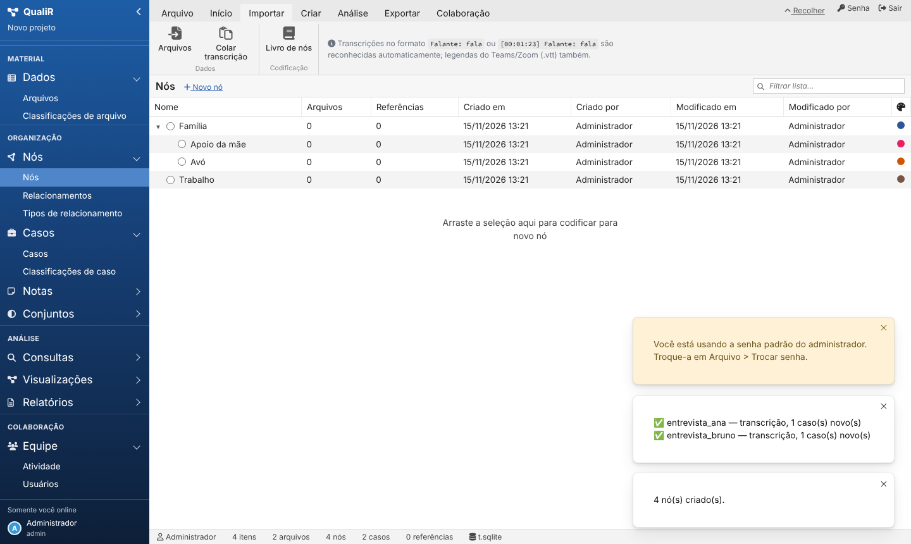

**Criar um nó:**
- **Criar > Novo nó** (ou **+ Novo nó**, no alto da lista de Nós);
- ou direto na hora de codificar (seção 7).

No formulário do nó você define:
- **Nome**;
- **Nó pai** (para hierarquia);
- **Descrição/definição**, que entra no livro de nós;
- **Cor**.

**Hierarquia:**
- **Criar > Nó filho** cria um nó dentro do nó selecionado.
- **Arraste** um nó sobre outro na lista para torná-lo filho. Para devolvê-lo ao nível superior, abra **Propriedades** e escolha "(nenhum)" em Nó pai.
- A seta **▸/▾** mostra ou esconde os nós filhos.

**Editar, mesclar e excluir:** dê duplo clique no nó e clique em **Propriedades**, ou use **Início > Propriedades**:
- **Mesclar** transfere toda a codificação e os nós filhos para outro nó e apaga o nó atual.
- **Excluir** apaga o nó, os nós filhos e as referências.

**Ver o conteúdo de um nó:** dê duplo clique nele. Aparecem todas as referências codificadas, agrupadas por arquivo, com o percentual de cobertura, quem codificou e o link **Abrir no arquivo**. A opção **Incluir nós filhos** agrega as referências dos nós filhos.

**Livro de nós:**
- **Importar > Livro de nós** lê uma planilha `.xlsx` ou `.csv` com as colunas **Nó** (ou "Código"), **Descrição** e **Cor** (opcional). Para hierarquia, escreva o caminho `Família \ Apoio da mãe` ou use uma coluna **Pai**.
- **Exportar > Livro de nós** gera um documento Word ou uma planilha Excel.

---

## 7. Codificar

Abra um arquivo (duplo clique) e **selecione um trecho** com o mouse. Depois, use a forma que preferir:

| Forma | Como |
|---|---|
| **Arrastar e soltar** | Com a lista de **Nós** visível ao lado, arraste a seleção até o nó. Soltar em "Arraste a seleção aqui para codificar para novo nó" cria um nó novo |
| **Botão direito** | Abre um menu com os nós e casos. Digite para filtrar e tecle Enter. Também oferece *novo nó*, *nova anotação* e *descodificar* |
| **Barra "Codificar em"** (rodapé) | Escolha **Lista: Nós ou Casos**, digite o nome e clique em ⊕. Se o nome não existir, o nó é criado. Atalho: **Ctrl+Q** |
| **Botões do documento** | **Codificar seleção**, **Novo nó** e **Descodificar** |
| **Duplo clique na árvore** | Com o **Painel** do documento aberto, um duplo clique em um nó codifica a seleção |

**Descodificar:** selecione o trecho e use **Descodificar**. Você escolhe de quais nós remover. Se a seleção cobrir só parte de uma codificação, apenas essa parte é removida.

**Clicar em um trecho destacado** mostra todas as codificações daquele ponto (nó, quem codificou e quando) e permite remover a sua.

### 7.1 Opções de exibição do documento

| Opção | Efeito |
|---|---|
| **Destacar** | todos os nós, só o nó selecionado ou nenhum |
| **Codificação de** | toda a equipe ou um membro específico |
| **Faixas** | barras coloridas à direita do texto, **por nó** ou **por codificador**. Clique numa faixa para destacar só aquele nó |
| **Casos** | inclui as falas codificadas em casos |
| **Gráfico** | cobertura de cada nó neste arquivo |
| **Consulta** | pesquisa de texto limitada ao arquivo |

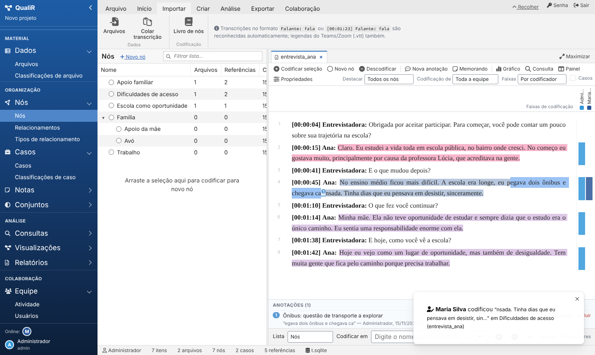

### 7.2 Codificação automática

- **Início > Autocodificar:**
  - *Falantes → casos* ou *Falantes → nós*: cria um item por falante e codifica as falas dele.
  - *Parágrafos que contêm um termo*: cria um nó com todos os parágrafos que contêm a palavra (aceita `*` e `OU`).
- **Início > Codificar intervalo:** codifica do parágrafo X ao Y. Os números dos parágrafos aparecem à esquerda do texto.
- Na **Pesquisa de texto** (seção 11), **Codificar todos os resultados** codifica de uma vez cada ocorrência, só o termo ou o parágrafo inteiro.

---

## 8. Casos e classificações

**Casos** representam as unidades de análise, normalmente participantes, mas também escolas, famílias etc. São criados automaticamente nas transcrições ou em **Criar > Caso**.

**Classificações de caso** é uma planilha de atributos (gênero, idade, escolaridade…):
1. **Criar > Atributo de caso** (ou **+ Novo atributo**).
2. Na planilha, **dê duplo clique na célula**, digite o valor e tecle **Enter**.

**Classificações de arquivo** funciona do mesmo jeito para os arquivos (escola, região, data, rodada de coleta…), em **Criar > Atributo de arquivo**.

Os atributos servem para comparar grupos na **Matriz de codificação** e para filtrar a **Consulta de codificação**.

---

## 9. Memorandos e anotações

**Memorandos** são textos livres de reflexão analítica:
- **Criar > Memorando** abre um memorando do projeto, do arquivo aberto ou do nó selecionado.
- No documento, o botão **Memorando** abre (ou cria) o memorando daquele arquivo.
- Clique em **Salvar nota**. Se outra pessoa salvou o mesmo memorando depois que você o abriu, o programa avisa antes de sobrescrever.

**Anotações** são comentários presos a um trecho do texto:
- Selecione o trecho e use **Nova anotação** (botão do documento, menu do botão direito ou **Criar > Anotação**).
- O trecho fica sublinhado em azul, com um número. A lista numerada aparece no rodapé do documento, com as opções *ir*, *editar* e *excluir*.
- Todas as anotações do projeto ficam em **Notas > Anotações**.

---

## 10. Conjuntos e relacionamentos

**Conjuntos** agrupam arquivos ou nós sem mudar a organização original (por exemplo, "Entrevistas de 2025" ou "Escolas públicas"):
- **Criar > Conjunto**.
- Para incluir itens: selecione um arquivo ou nó na lista e use **Início > Adicionar ao conjunto**. Dá para digitar o nome de um conjunto novo.
- Nas consultas, os conjuntos aparecem no campo **Arquivos** como escopo.

**Relacionamentos** registram ligações entre nós ou casos (por exemplo, "Apoio familiar *influencia* Permanência na escola"):
- **Tipos de relacionamento:** já vêm *Associado a*, *Influencia*, *Leva a* e *Contradiz*. Crie outros em **Criar > Tipo de relacionamento**, com a direção associativa (—), unidirecional (→) ou simétrica (↔).
- **Criar > Relacionamento**: escolha *De*, *Tipo* e *Para*, e registre a evidência na descrição.
- Para ver todos: **Visualizações > Mapa de relacionamentos**.

---

## 11. Consultas

Todas as consultas ficam na aba **Análise** e em **Consultas** na barra lateral. Cada uma abre com os parâmetros à esquerda e os resultados à direita. Em todas há:
- **Salvar consulta:** guarda os parâmetros para executar de novo depois. Fica disponível para toda a equipe em **Consultas**.
- **Exportar resultados (Excel).**

### Frequência de palavras
Lista as palavras mais usadas, já sem palavras vazias como "de", "que" e "né", e mostra uma **nuvem** e um **gráfico**. O escopo pode ser todos os arquivos, alguns arquivos ou só os trechos de um nó. A opção *Ignorar nomes de falantes e marcações de tempo* vem ligada. Selecione uma palavra para pesquisá-la ou ver sua árvore.

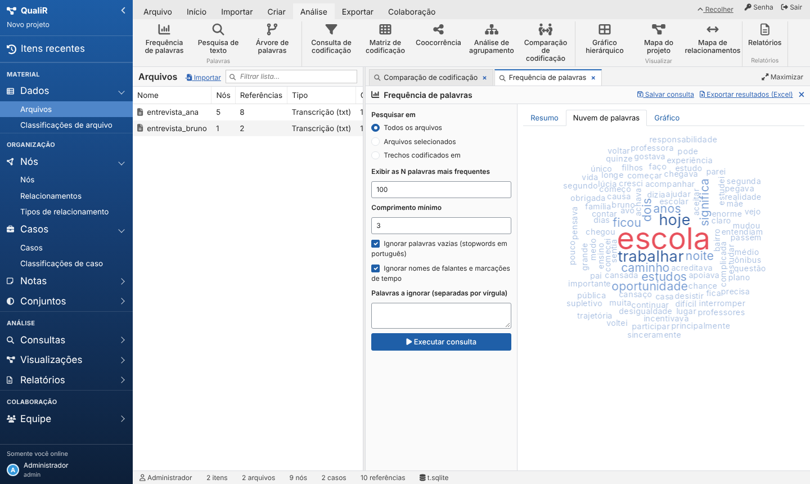

### Pesquisa de texto
Mostra cada ocorrência com o contexto à esquerda e à direita. Clique numa linha para abrir o arquivo no trecho. A busca aceita:
- `escol*`: escola, escolar, escolaridade…
- `"saúde mental"`: frase exata;
- `medo OU receio`: qualquer um dos termos.

Também é possível **codificar todos os resultados** ou **salvar em Resultados da consulta**.

### Árvore de palavras
Mostra, em ramos, o que costuma vir **antes** e **depois** de uma palavra. O tamanho da fonte indica a frequência.

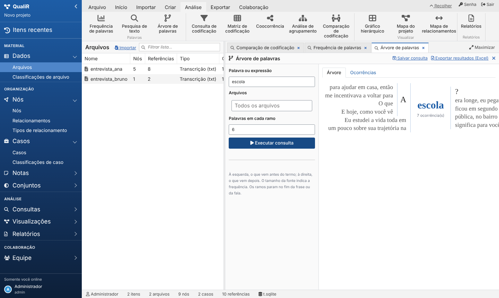

### Consulta de codificação
Recupera trechos codificados em um nó, combinados com outro nó:
- **E:** trechos codificados nos dois nós;
- **OU:** trechos em qualquer um dos dois;
- **NÃO:** trechos no primeiro, mas não no segundo.

O campo **Somente nas falas de** restringe a casos ou atributos, por exemplo "Gênero = Feminino". Os resultados podem virar um **novo nó** ou ficar em **Resultados da consulta**.

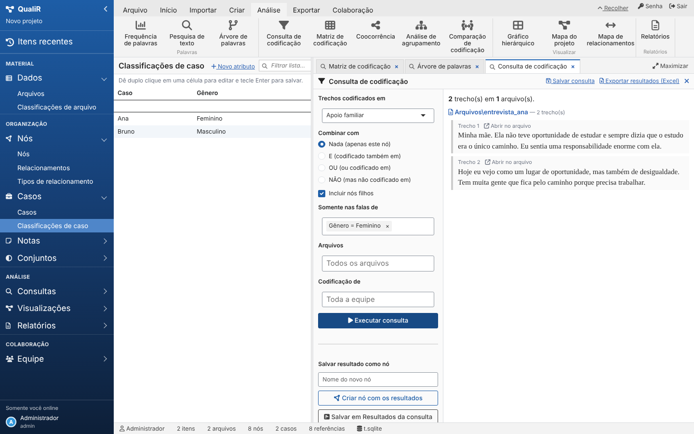

### Matriz de codificação
Cruza nós (linhas) com **arquivos, casos, atributos de caso, atributos de arquivo ou codificadores** (colunas). A célula mostra o número de referências ou de arquivos; quanto mais escura, maior o valor. **Clique numa célula** para ler os trechos. **Salvar matriz** guarda o resultado em *Consultas > Matrizes de codificação*.

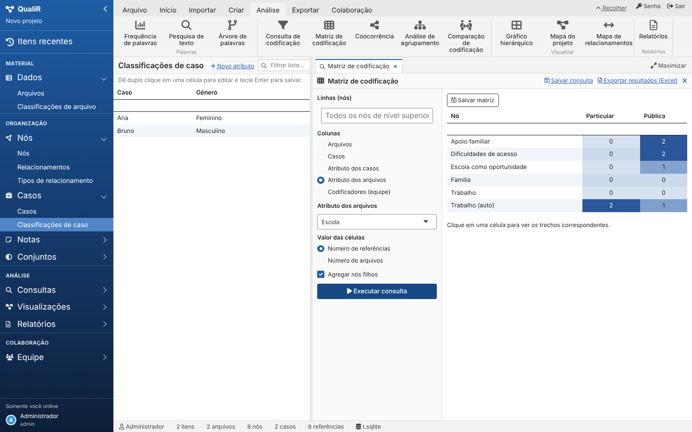

### Coocorrência
Mostra quais nós aparecem juntos nos mesmos trechos, em rede, matriz ou lista de pares.

### Análise de agrupamento
Agrupa **nós** ou **arquivos** parecidos e mostra um dendrograma:
- **por codificação:** nós que aparecem nos mesmos parágrafos, ou arquivos codificados de forma parecida;
- **por palavras:** vocabulário semelhante.

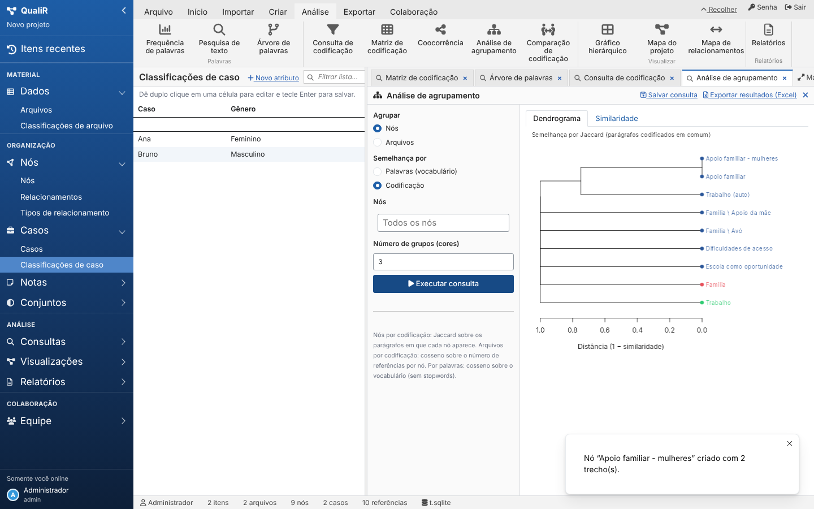

### Comparação de codificação
Compara a codificação dos usuários A e B (ou de grupos), caractere a caractere: **concordância (%)** e **Kappa de Cohen**, por nó e por arquivo. As cores indicam o nível: vermelho abaixo de 0,40, amarelo de 0,40 a 0,75 e verde acima de 0,75.

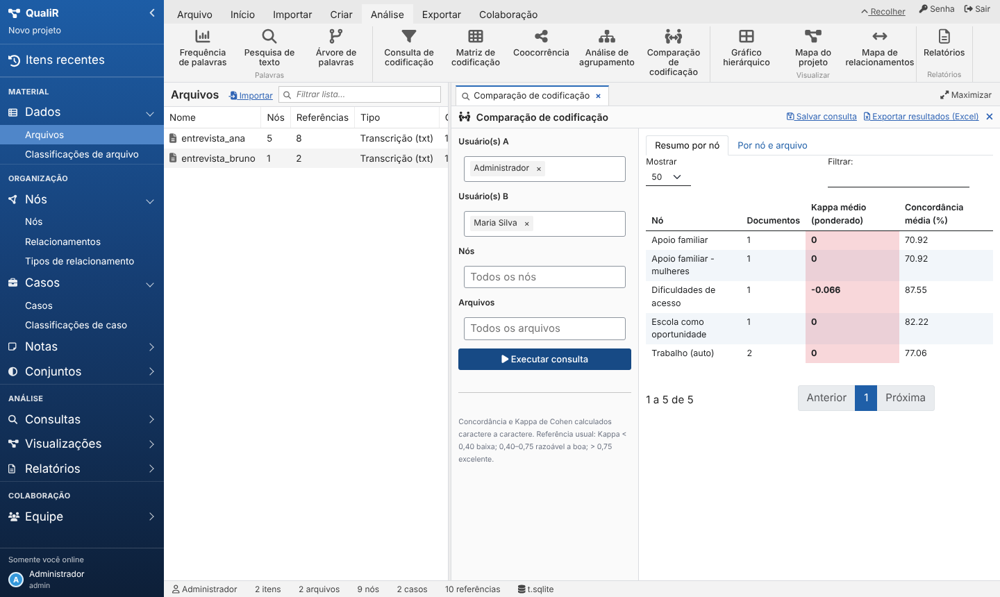

---

## 12. Visualizações e relatórios

**Visualizações > Mapas e gráficos** (ou aba **Análise**):

| Visualização | Mostra |
|---|---|
| **Gráfico hierárquico** | retângulos proporcionais às referências de cada nó e nó filho |
| **Mapa do projeto** | arquivos, nós e casos ligados pela codificação |
| **Mapa de relacionamentos** | os relacionamentos definidos, com setas conforme a direção |
| **Rede de coocorrência** | nós que aparecem juntos |
| **Gráfico de codificação por arquivo** | referências de cada nó em cada arquivo |

Todas podem ser salvas em **PNG** para usar em artigos e apresentações.

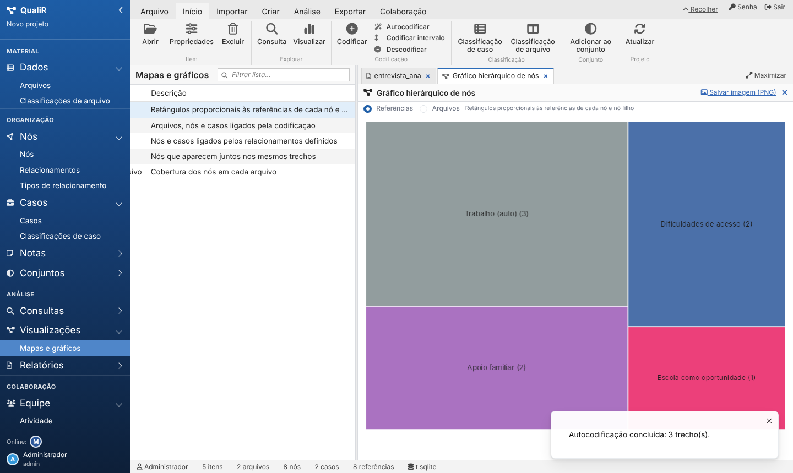

**Relatórios:**
- resumo dos nós;
- resumo dos arquivos;
- resumo dos casos e atributos;
- codificação por arquivo;
- trechos codificados por nó;
- anotações e memorandos;
- codificação por membro da equipe.

Cada relatório é exportado em **Word** ou **Excel**.

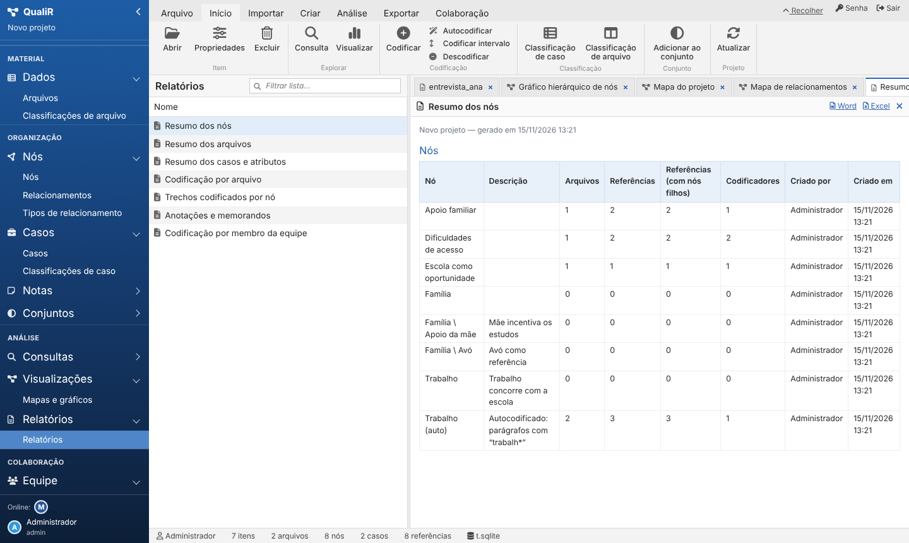

---

## 13. Trabalho em equipe

O QualiR roda em **um** computador ou servidor, onde fica o arquivo do projeto, e todos acessam pelo navegador. Os colegas não precisam instalar nada.

### 13.1 Na mesma rede (laboratório, universidade, casa)

1. No computador que vai servir o projeto, dê dois cliques em **`Iniciar QualiR (equipe).bat`**. No RStudio, o equivalente é:
   ```r
   shiny::runApp(".", host = "0.0.0.0", port = 3838)
   ```
2. Se o **Firewall do Windows** perguntar, marque *Redes privadas* e clique em *Permitir acesso*.
3. A janela mostra o endereço, por exemplo `http://192.168.0.15:3838`. Envie esse endereço aos colegas. Para descobrir o IP manualmente, use `ipconfig` no Prompt de Comando, linha "Endereço IPv4".
4. Esse computador precisa ficar **ligado e sem entrar em suspensão** enquanto a equipe trabalha.

Se os colegas não conseguirem acessar, a rede pode estar bloqueando a porta 3838 (comum em redes de universidade). Peça a liberação ao setor de TI ou use um servidor.

### 13.2 Pela internet

Instale o QualiR em um servidor Linux com **Shiny Server** (gratuito) ou em um **Posit Connect** da instituição. Defina `QUALIR_PROJETOS` para uma pasta com cópia de segurança automática.

Não use o shinyapps.io: ele apaga os arquivos ao reiniciar, e o projeto se perderia.

### 13.3 Como a colaboração funciona

- O que um membro faz aparece para os demais em cerca de **1 segundo**, com uma notificação ("Maria codificou … em …").
- O nome de quem está **online** aparece no rodapé da barra lateral.
- **Cada codificação guarda o autor.** Use *Codificação de* e *Faixas por codificador* para ver o trabalho de cada pessoa.
- Cada pessoa só remove a própria codificação; o administrador pode remover qualquer uma.
- **Equipe > Atividade** registra o histórico de ações.

### 13.4 Boas práticas para codificação em equipe

1. Definam juntos o **livro de nós**, com descrição clara em cada nó.
2. Façam uma **rodada piloto**: duas pessoas codificam os mesmos arquivos de forma independente (com *Codificação de* = cada uma).
3. Rodem a **Comparação de codificação**, discutam os nós com Kappa baixo e ajustem as definições.
4. Registrem as decisões em **memorandos**.
5. Dividam os arquivos restantes e façam **cópias de segurança** com frequência.

---

## 14. Exportar, fazer cópia de segurança e proteger os dados

**Aba Exportar:**

| Opção | Gera |
|---|---|
| **Codificação (Excel)** | todas as referências (arquivo, nó, codificador, trecho, data), o livro de nós, os casos e os arquivos |
| **Livro de nós** | documento Word ou planilha Excel |
| **Arquivo aberto com codificação** | Word com o texto e, para cada nó, os trechos codificados e as anotações |
| **Cópia de segurança** | cópia completa do projeto (somente o administrador) |

**Cópia de segurança:** cada projeto inteiro está em um arquivo `.sqlite` da pasta `projetos`. Faça cópias com frequência, pelo botão **Arquivo > Cópia de segurança** (o arquivo baixado leva o nome do projeto e a data) ou copiando a pasta `projetos` com o programa fechado. Para **restaurar**, use **Arquivo > Importar projeto** e escolha a cópia (seção 3.5).

**Proteção dos dados (ética e LGPD):**
- Os arquivos `.sqlite` da pasta `projetos` contêm as transcrições: **guarde-os em local seguro e nunca os publique no GitHub** (o `.gitignore` já exclui a pasta).
- **Anonimize as transcrições antes de importar**, trocando nomes por códigos como P1 e P2.
- Use senhas individuais e o perfil **Leitor(a)** para quem só precisa consultar.

---

## 15. Atalhos e dicas

| Ação | Como |
|---|---|
| Ir para "Codificar em" | **Ctrl+Q** |
| Abrir item | duplo clique na lista |
| Codificar rapidamente | selecionar o trecho, botão direito, digitar parte do nome, Enter |
| Ganhar espaço para ler | **Recolher** a faixa e **Maximizar** o documento |
| Ajustar a largura da lista | arrastar a divisória entre a lista e o documento |
| Ir a um parágrafo | os números à esquerda do texto servem de referência (e para *Codificar intervalo*) |
| Salvar célula da planilha | duplo clique, digitar, **Enter** |
| Atualizar tudo | **Início > Atualizar** |

---

## 16. Solução de problemas

| Problema | Solução |
|---|---|
| `file.exists("app.R")` responde `FALSE` | A pasta escolhida está errada. Rode `list.files()`: se aparecer só `qualiR`, rode `setwd("qualiR")`; se aparecer `qualiR.zip`, extraia o arquivo antes |
| `there is no package called 'xxx'` | `install.packages("xxx")` |
| Aviso sobre **Rtools** | Pode ser ignorado |
| Acentos estranhos (é, ç) | Atualize o R para 4.2 ou mais recente |
| Não consigo digitar no campo de nó | Clique no campo e espere um instante; o item escolhido some e o campo libera a digitação |
| PDF importado sem texto | O PDF é escaneado (imagem). Faça OCR antes |
| Transcrição não reconhecida | Confira se as linhas seguem `Nome: fala` e se cada falante aparece mais de uma vez |
| Colegas não acessam pela rede | Verifique o firewall, se estão na mesma rede e o IP (que pode mudar quando o computador reinicia) |
| "Usuário ou senha inválidos para este projeto" | Confira se escolheu o projeto certo na lista: os usuários são de cada projeto |
| `Failed to create server` / porta em uso | O QualiR já está aberto em outra janela. Feche-a ou use outra porta (`port = 3839`) |
| Esqueci a senha do admin | Outro administrador pode redefinir em Equipe > Usuários. Se não houver outro, rode no R, com o programa fechado e na pasta do QualiR (troque o nome do arquivo pelo do seu projeto): `source("R/util.R"); source("R/db.R"); con <- db_conectar("projetos/meu_projeto.sqlite"); db_trocar_senha(con, 1, "novaSenha")` |
| O banco ficou lento com muitas pessoas | O SQLite atende bem cerca de 15 pessoas ao mesmo tempo. Acima disso, use um servidor dedicado |

### Limitações conhecidas

- O texto não pode ser editado após a importação.
- O programa trabalha só com texto: não codifica áudio, vídeo ou imagem (importe as transcrições).
