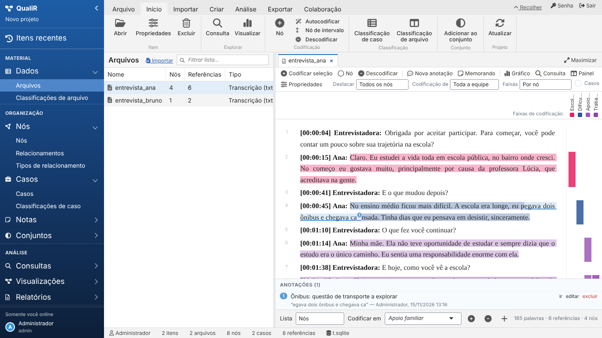
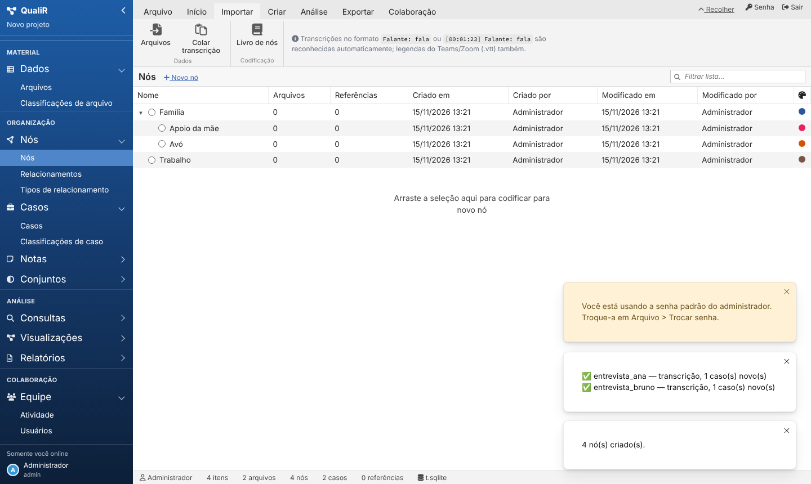
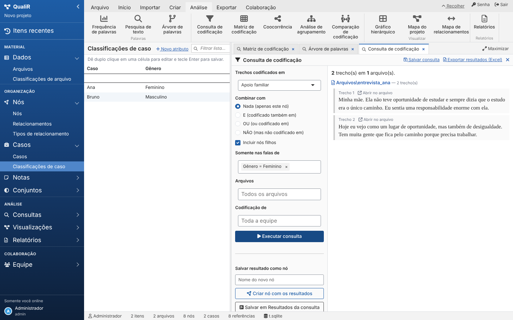
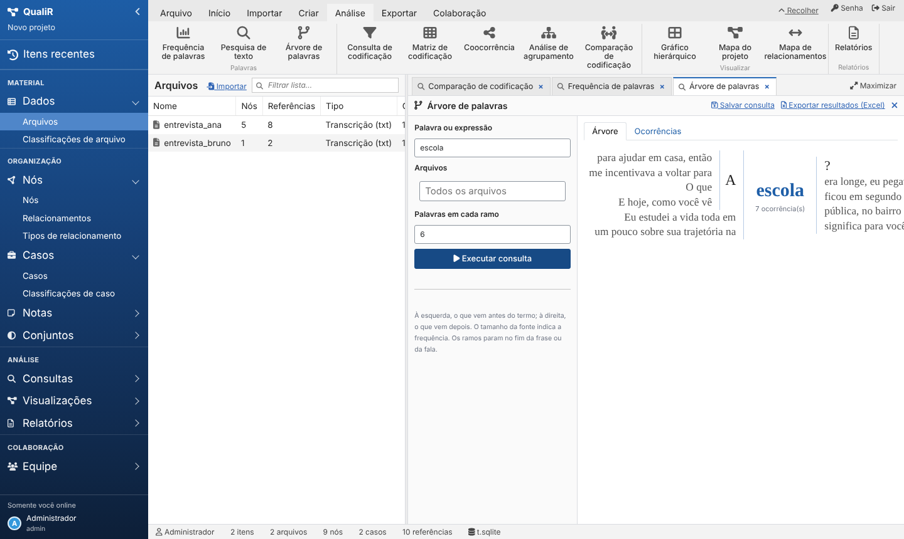
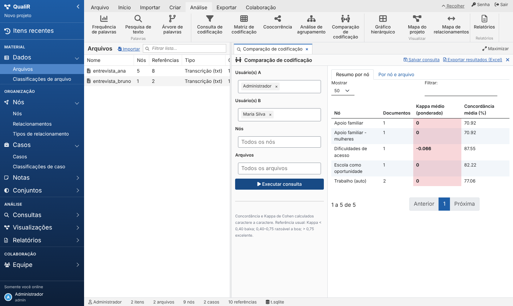

# QualiR

**Análise qualitativa de textos e transcrições em R, para trabalhar sozinho ou em equipe.**

O QualiR é um aplicativo gratuito e de código aberto, feito em R/Shiny. Ele organiza entrevistas, grupos focais e outros documentos, codifica trechos em **nós** hierárquicos e oferece consultas para explorar os dados. Várias pessoas podem codificar o mesmo projeto ao mesmo tempo, cada uma pelo próprio navegador.



## Principais recursos

- **Importação** de `.txt`, `.docx`, `.pdf`, legendas `.vtt`/`.srt` (Teams, Zoom, Whisper) e texto colado.
- **Transcrições reconhecidas automaticamente** (`Falante: fala` ou `[00:01:23] Falante: fala`), com um caso criado para cada participante.
- **Nós hierárquicos** com cor e descrição, mesclagem e livro de nós (importação e exportação).
- **Codificação** por arrastar e soltar, menu do botão direito ou barra "Codificar em" (Ctrl+Q), com faixas de codificação por nó ou por codificador.
- **Casos e atributos** de casos e de arquivos, **memorandos**, **anotações**, **conjuntos** e **relacionamentos**.
- **Consultas:**
  - frequência de palavras e nuvem;
  - pesquisa de texto e árvore de palavras;
  - consulta de codificação (E / OU / NÃO, filtrada por atributos);
  - matriz de codificação;
  - coocorrência e análise de agrupamento;
  - comparação entre codificadores (Kappa de Cohen).
- **Visualizações** (gráfico hierárquico, mapa do projeto, mapa de relacionamentos) e **relatórios** em Word e Excel.
- **Vários projetos:** criar, abrir e importar projetos (aba Arquivo), cada um com seus próprios dados e usuários.
- **Trabalho em equipe:** login com perfis, atualização ao vivo, registro de atividade e de quem está online.

| | |
|---|---|
|  |  |
|  |  |

## Instalação rápida

1. Instale o [R](https://cran.r-project.org) (4.2 ou mais recente) e, se quiser, o [RStudio](https://posit.co/download/rstudio-desktop).
2. Baixe este repositório: botão verde **Code > Download ZIP**, e extraia a pasta.
3. No R ou no RStudio:

   ```r
   setwd(choose.dir())            # escolha a pasta do QualiR (no Mac/Linux use setwd("caminho/da/pasta"))
   source("instalar_pacotes.R")   # só na primeira vez
   shiny::runApp(".")
   ```

4. Na primeira vez, clique em **Criar o primeiro projeto**, dê um nome e crie seu usuário administrador.

No Windows, depois da instalação dos pacotes, basta dar dois cliques em **`Iniciar QualiR.bat`**.

O passo a passo completo, com todas as funções, está no **[Manual de uso](MANUAL.md)**.

## Trabalho em equipe

O QualiR roda em um único computador ou servidor, e a equipe acessa pelo navegador:

```r
shiny::runApp(".", host = "0.0.0.0", port = 3838)
```

No Windows, use **`Iniciar QualiR (equipe).bat`**. Ele mostra o endereço que os colegas devem abrir, por exemplo `http://192.168.0.15:3838`. Veja a seção 13 do manual.

## Privacidade dos dados

Cada projeto é um arquivo `.sqlite` na pasta `projetos/`. **Esses arquivos contêm os dados da pesquisa e nunca devem ser enviados ao GitHub.** O `.gitignore` deste repositório já exclui a pasta e qualquer `.sqlite`.

## Estrutura

```
app.R                  ponto de entrada
instalar_pacotes.R     instala as dependências
R/                     código (projetos, banco de dados, importação, análises, interface)
www/                   estilo (CSS) e interações (JavaScript)
exemplos/              duas transcrições fictícias para teste
docs/img/              imagens do manual
projetos/              seus projetos (criada automaticamente; não vai para o GitHub)
MANUAL.md              manual de uso
```

## Licença

[MIT](LICENSE): uso, cópia e modificação livres, mantendo o aviso de licença.
